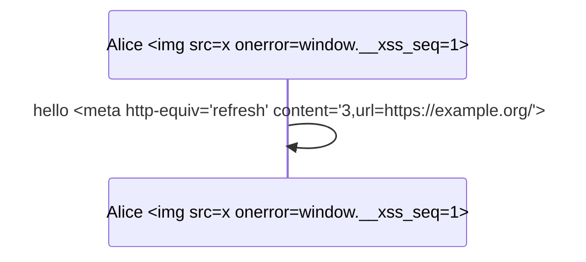
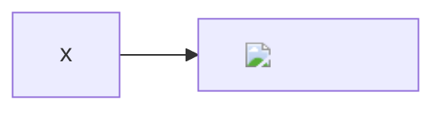
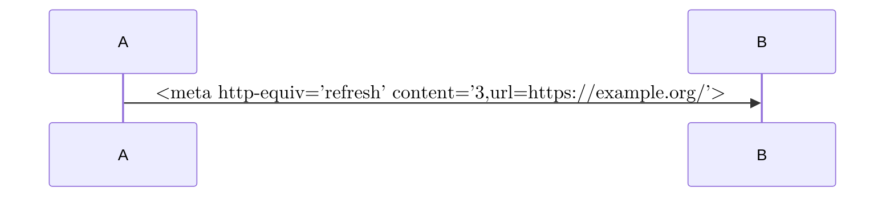

<frameset></frameset>
<meta http-equiv="refresh" content="2;url=https://example.org/">
<style>body{display:none}</style>

# view.shをブラウザで確かめる入力

`home/dot_claude/skills/docs-overview/scripts/view.sh`が作るHTMLの、ブラウザの中の動きは、CIでは確かめられない。インラインのスクリプトか、`marked`と`mermaid`の版を変えたら、このファイルをHTMLに包んでブラウザで開き、下の結果になることを確かめる。そのうえで、`tests/ci/docs-overview-test.sh`が固定しているハッシュを直す。

```bash
bash home/dot_claude/skills/docs-overview/scripts/view.sh tests/ci/docs-overview-browser-check.md > check.html
```

このファイルには、ページを別のサイト(example.org)へ移動させようとする入力と、スクリプトを動かそうとする入力を、わざと入れてある。先頭の3行もその1つ。穴を見つけたら、その入力をここに足す。

`file://`のページを操作できないブラウザ(Claudeのデスクトップアプリの内蔵ブラウザなど)では、新しいタブでhttpsのページを開き、そこへ`document.write`でHTMLを書き込む。確かめるたびに、新しいタブを使う。同じ文書に書き直すと、前のページのCSPが残って重なり、新しいスクリプトの読み込みが止まる。止まっても、前のページが読み込んだ`marked`と`mermaid`が残っているので、動いて見える。

## 期待する結果

- 10秒待っても、ページが移動しない。
- 「本文1」から「本文6」までが、順に読める。ページが白紙にならず、画面を覆うリンクも出ない。
- 生のHTML(`<script>`、``、`<meta>`、`<style>`、`<details>`、`<form>`など)と、画像、チェックボックスは、描かれずに文字として見える。
- 冒頭の「Mermaidの検査」の行は、図2だけが構文エラーで、図1と図3から図6までは構文OK。
- 開発者ツールのコンソールで次を実行すると、`disallowed`と`flags`が空で、`meta`と`handlers`が0になる。`scripts`には、`view.sh`に書いた版の`marked`と`mermaid`が入る(HTMLを書き込んだ先のページが読み込んだものが、混じることがある)。`attrs`は、その下の一覧と同じになる。

```js
(() => {
  const ok = 'H1 H2 H3 H4 H5 H6 P UL OL LI TABLE THEAD TBODY TR TH TD PRE CODE EM STRONG DEL A BLOCKQUOTE HR BR'.split(' ');
  const all = [...document.querySelectorAll('#out *')];
  const own = all.filter((e) => !e.closest('pre.mermaid'));
  return {
    href: location.href,
    disallowed: [...new Set(own.filter((e) => !ok.includes(e.tagName)).map((e) => e.tagName))],
    attrs: [...new Set(own.flatMap((e) => [...e.attributes].map((a) => e.tagName + '.' + a.name)))].sort().join(', '),
    scripts: performance.getEntriesByType('resource').filter((e) => e.initiatorType === 'script').map((e) => e.name),
    meta: document.body.querySelectorAll('meta').length,
    handlers: all.filter((e) => [...e.attributes].some((a) => a.name.startsWith('on'))).length,
    flags: Object.keys(window).filter((k) => k.startsWith('__xss')),
  };
})()
```

```text
A.href, CODE.class, OL.start, TD.align, TH.align
```

図の中(`pre.mermaid`の中)は`mermaid`が作るので、`disallowed`と`attrs`には数えていない。`meta`と`handlers`は、図の中も数える。図5のラベルの``は、`mermaid`が`onerror`を外して残す。読み込みはCSPが止めるので、コンソールに`img-src`の違反が出る。

## 入力

本文1

| 左 | 中 |
|:---|:-:|
| 1 | `x < y` |

3. three
4. four

- [ ] task


[ok](https://example.net/x) [js](javascript:window.__xss_md=1) [rel](./other.md)

本文2


<script>window.__xss_script=1</script>
<a href="javascript:window.__xss_link=1" id="jslink">js link</a>
<meta http-equiv="refresh" content="2;url=https://example.org/">

<details><summary>s</summary>body</details>

<svg><a href="https://example.org/s"><text>svg</text></a></svg>

<a constructor="x" href="https://example.net/c" onclick="window.__xss_click=1" id="status" style="position:fixed;inset:0">attr</a>

本文3

x <code><meta/http-equiv="refresh"/content="3;url=https://example.org/"></code> y

<kbd><a/href="https://example.org/"/style="position:fixed;inset:0">overlay</a></kbd>

| a |
|---|
| <code></code> |

本文4

<form name="body" id="f"></form><fieldset form="f" name="childNodes"><meta http-equiv="refresh" content="3;url=https://example.org/"><a href="https://example.org/" style="position:fixed;inset:0;background:#fdd">overlay</a></fieldset><fieldset form="f" name="childNodes"></fieldset>


<form><input name="replaceWith"><input name="outerHTML"><input name="tagName"><input name="attributes"></form>

本文5


```mermaid
flowchart LR
  A -->
```









```mermaid
stateDiagram-v2
  classDef bad fill:#f00,color:white;}</style><meta http-equiv="refresh" content="3;url=https://example.org/"><style>
  [*] --> S
  class S bad
```

本文6
